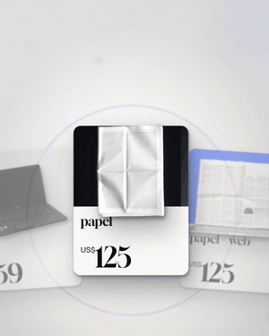
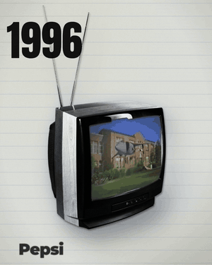
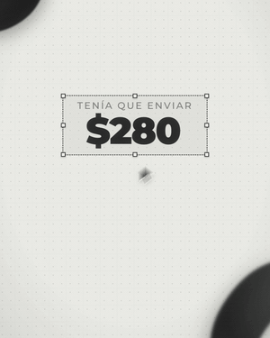
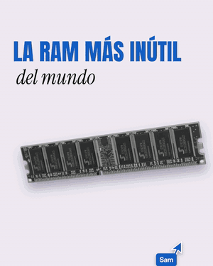
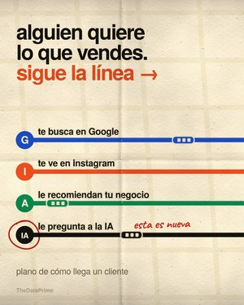
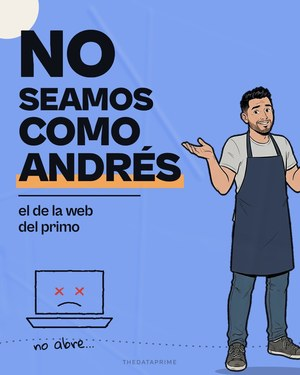

<p align="center">
  <picture>
    <source media="(prefers-color-scheme: dark)" srcset="./banner.gif">
    <source media="(prefers-color-scheme: light)" srcset="./banner-claro.gif">
    
  </picture>
</p>

<h1 align="center">Hola, soy Shark</h1>

<p align="center"><b>AI Product Engineer</b> · Kualki by TheDataPrime</p>

<p align="center">
  
</p>

<p align="center">
  <a href="https://thedataprime.com/"></a>
  <a href="https://www.instagram.com/sharky.sff/"></a>
  <a href="https://discord.com/users/699419493033836595"></a>
</p>

---

## Cómo trabajamos

<picture>
  <source media="(prefers-color-scheme: dark)" srcset="./como-trabajamos/oscuro.svg">
  <source media="(prefers-color-scheme: light)" srcset="./como-trabajamos/claro.svg">
  
</picture>

## Lo que construimos

Primero entendemos el negocio y a quien lo va a usar. Después lo construimos.

<table>
  <tr>
    <td width="33%" valign="top">
      <br>
      <b>Software a la medida</b><br>
      <sub>Herramientas que se adaptan a cómo trabaja cada negocio, no al revés.</sub>
    </td>
    <td width="33%" valign="top">
      <br>
      <b>Sitios y tiendas</b><br>
      <sub>Diseñados para cada marca y sus clientes, nunca desde una plantilla.</sub>
    </td>
    <td width="33%" valign="top">
      <br>
      <b>Apps</b><br>
      <sub>De la idea a algo que la gente usa todos los días.</sub>
    </td>
  </tr>
  <tr>
    <td width="33%" valign="top">
      <br>
      <b>Automatización e IA</b><br>
      <sub>Bots y herramientas que se encargan de lo repetitivo.</sub>
    </td>
    <td width="33%" valign="top">
      <br>
      <b>Video</b><br>
      <sub>3D, tipografía en movimiento y sonido, hechos con código propio.</sub>
    </td>
    <td width="33%" valign="top"></td>
  </tr>
</table>

```js
const kualki = {
  idea: "bien pensada",
  experiencia: "primero",
  código: "después",
};
```

> Humano en la idea. IA en el oficio.

## Trabajo reciente

<table>
  <tr>
    <td width="33%" align="center" valign="top">
      <a href="https://www.instagram.com/reel/Df5vQ19hic4/"></a><br>
      <sub><b>Este pato te hizo pagar más</b></sub>
    </td>
    <td width="33%" align="center" valign="top">
      <a href="https://www.instagram.com/reel/DfqIiAsPJmi/"></a><br>
      <sub><b>El avión de Pepsi</b></sub>
    </td>
    <td width="33%" align="center" valign="top">
      <a href="https://www.instagram.com/reel/DfQF0TSvl6f/"></a><br>
      <sub><b>La tecla más cara del mundo</b></sub>
    </td>
  </tr>
  <tr>
    <td width="33%" align="center" valign="top">
      <a href="https://www.instagram.com/reel/DfYFvJjPE70/"></a><br>
      <sub><b>La pelea por tu RAM</b></sub>
    </td>
    <td width="33%" align="center" valign="top">
      <a href="https://www.instagram.com/p/DfVPskDjxxT/"></a><br>
      <sub><b>Sigue la línea</b></sub>
    </td>
    <td width="33%" align="center" valign="top">
      <a href="https://www.instagram.com/p/Df-vs0rD8Qk/"></a><br>
      <sub><b>No seamos como Andrés</b></sub>
    </td>
  </tr>
</table>

<p align="center"><a href="https://www.instagram.com/thedataprime/">Ver más en Instagram →</a></p>

## Con qué trabajo

<p align="center">
  <picture>
    <source media="(prefers-color-scheme: dark)" srcset="https://skillicons.dev/icons?i=ts%2Cjs%2Cpy%2Creact%2Cnextjs%2Cnodejs%2Ctailwind%2Cthreejs%2Cvercel%2Cfirebase%2Csupabase%2Cblender&theme=dark">
    <source media="(prefers-color-scheme: light)" srcset="https://skillicons.dev/icons?i=ts%2Cjs%2Cpy%2Creact%2Cnextjs%2Cnodejs%2Ctailwind%2Cthreejs%2Cvercel%2Cfirebase%2Csupabase%2Cblender&theme=light">
    
  </picture>
</p>
<p align="center">
  
  
  
  
  
  
</p>

## Actividad

<!-- La tarjeta de racha se llena cuando se activen las contribuciones privadas:
     GitHub > foto de perfil > Settings > Public profile > «Include private contributions on my profile». -->
<p align="center">
  <picture>
    <source media="(prefers-color-scheme: dark)" srcset="https://streak-stats.demolab.com?user=SharkySff&locale=es&disable_animations=true&hide_border=true&background=00000000&ring=FF7A2F&fire=FF7A2F&currStreakNum=F6F0E4&sideNums=F6F0E4&currStreakLabel=FF7A2F&sideLabels=F6F0E4&dates=A9AED6&stroke=30363D">
    <source media="(prefers-color-scheme: light)" srcset="https://streak-stats.demolab.com?user=SharkySff&locale=es&disable_animations=true&hide_border=true&background=00000000&ring=FF7A2F&fire=FF7A2F&currStreakNum=1D2766&sideNums=1D2766&currStreakLabel=FF7A2F&sideLabels=1D2766&dates=5B6290&stroke=D0D7DE">
    
  </picture>
</p>

<!-- La serpiente la genera cada día .github/workflows/serpiente.yml y la publica en la rama «output». -->
<p align="center">
  <picture>
    <source media="(prefers-color-scheme: dark)" srcset="https://raw.githubusercontent.com/SharkySff/SharkySff/output/serpiente-oscura.svg">
    <source media="(prefers-color-scheme: light)" srcset="https://raw.githubusercontent.com/SharkySff/SharkySff/output/serpiente-clara.svg">
    
  </picture>
</p>

<p align="center">
  
</p>

<p align="center">
  
</p>
